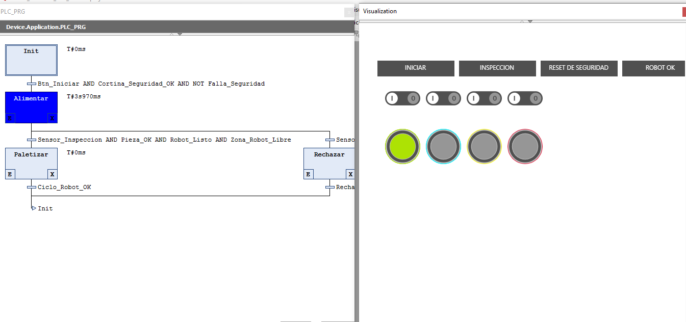
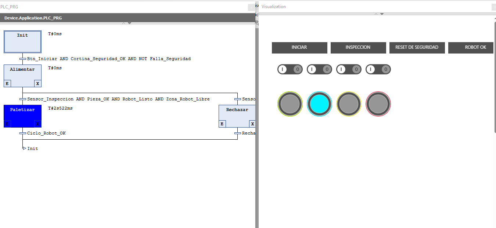
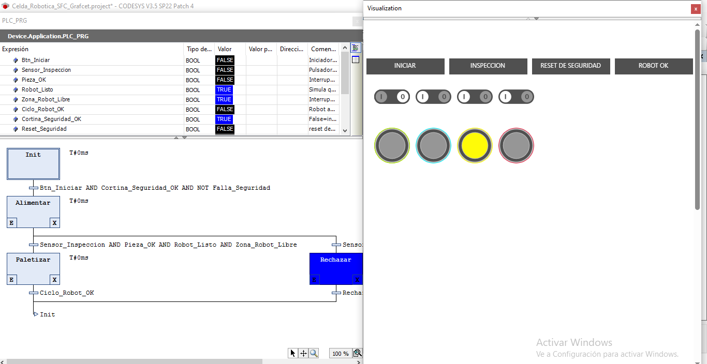
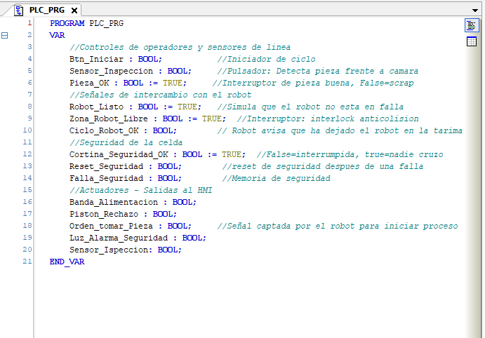
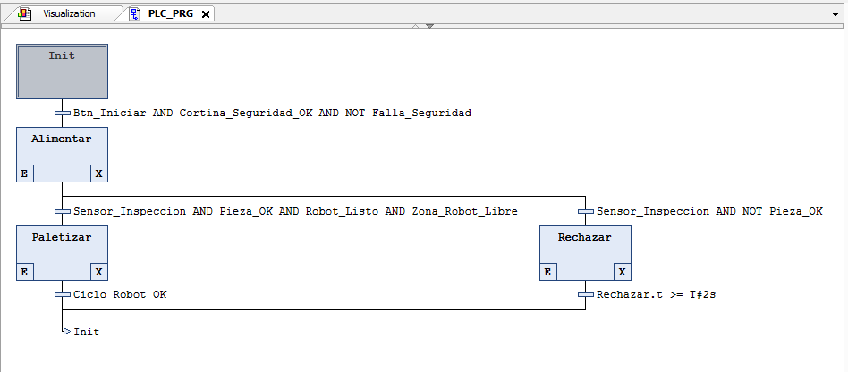

# Celda Automatizada de Inspección y Paletizado Robótico (IEC 61131-3 / SFC)

## Descripción del Proyecto
Control secuencial y gestión de seguridad en una celda robótica de manufactura, creada en CODESYS V3.5 (SP22), utilizando diagrama
secuencial (SFC/Grafcet) y texto estructurado (ST).
El sistema coordina banda de alimentación, zona de inspección y clasificacion automaticá
con vision artificial (componente Ok vs. no Ok), intercambio de señales
con un robot industrial de paletizado y medidas de zona de 
seguridad por medio de una cortia óptica.

## Arquitectura y Flujo de Control (Grafcet)
1. **Reposo (`Init`):** Antes de iniciar proceso verifica que la cortina de seguridad no se encuentre obstruida y que la celda no se encuentre en falla.
2. **Alimentación (`Alimentar`):** Activa la banda transportadora hasta detectar presencia en el area de inspección (`Sensor_Inspeccion`)
3. **Bifurcación Alternativa (Decisión de Calidad):**
   * **Ruta A — Paletizado (`Paletizar`):** Verificacion de pieza en buenas condiciones (`Pieza_OK`) y si el robot se encuentra disponible (`Zona_Robot_Libre`) se da la señal ('Orden_Tomar_Pieza') y es llevada al area de paletizado, esperando la cofirmacion final (`Ciclo_Robot_OK`).
   * **Ruta B — Rechazo (`Rechazar`):** Si la pieza falla la ispección (`NOT Pieza_OK`), activa el pistón neumático de desvío (`Rechazar.t >= T#2s`) a la linea de scrap.

---

## Tabla de Entradas, Salidas e Interlocks (I/O List)

| Señal / Variable | Tipo | Categoría | Función en la Celda |
| :--- | :--- | :--- | :--- |
| `Btn_Iniciar` | `BOOL` | Entrada | Arranque de ciclo automático |
| `Sensor_Inspeccion` | `BOOL` | Entrada | Presencia de pieza frente a cámara |
| `Pieza_OK` | `BOOL` | Entrada | Resultado de inspección (`TRUE` = Buena, `FALSE` = Scrap) |
| `Robot_Listo` | `BOOL` | Interlock | Estado operativo del robot |
| `Zona_Robot_Libre` | `BOOL` | Interlock | Permiso anti-colisión en área de toma |
| `Cortina_Seguridad_OK` | `BOOL` | Seguridad | Barrera óptica perimetral (`FALSE` = Interrumpida) |
| `Reset_Seguridad` | `BOOL` | Seguridad | Rearme manual tras despejar cortina |
| `Banda_De_Alimentacion` | `BOOL` | Salida | Motor de banda transportadora |
| `Orden_Tomar_Pieza` | `BOOL` | Salida | Solicitud de ciclo al robot |
| `Piston_Rechazo` | `BOOL` | Salida | Actuador de desvío de scrap |
| `Luz_Alarma_Seguridad` | `BOOL` | Salida | Baliza de advertencia por falla de seguridad |

## Simulación HMI — Estados Validados

### 1. Alimentación de Banda

### 2. Ciclo Nominal de Paletizado

### 3. Desvío Automático de Scrap (Rechazo)

### 4. Tabla de variables

### 5. Diagrama 

